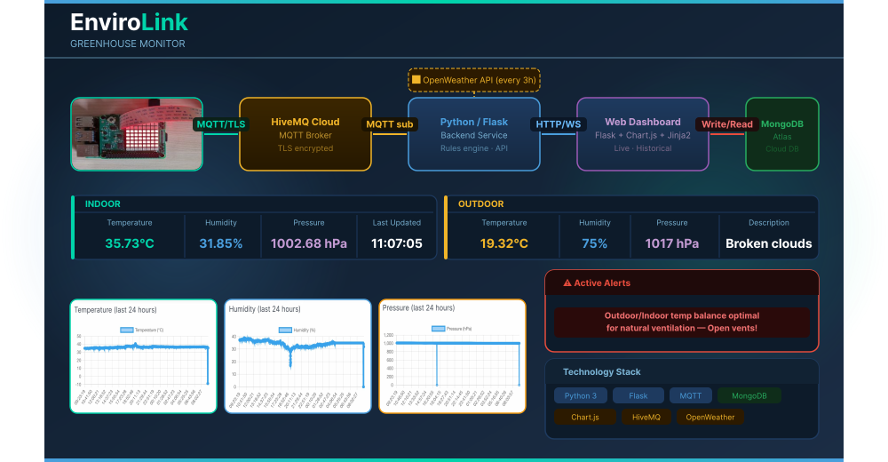

# 🌱 EnviroLink 🌱 Greenhouse Monitor



## Project overview
EnviroLink is a connected IoT system that monitors greenhouse conditions in real time using a Raspberry Pi with a SenseHAT, and combines live indoor readings with outdoor weather data from the OpenWeather API. It provides users with a unified view of both their indoor environment and outdoor forecast, enabling smarter decisions like opening vents when outdoor conditions are favourable, or alerting when frost is forecast.
The system features 24-hour historical trend charts, a real-time updating dashboard, colour-coded alerts based on a greenhouse rules engine, and visual feedback directly on the SenseHAT LED matrix.

## Architecture
See docs/architecture.svg for the full system diagram.
* Sensor/Edge Layer: Raspberry Pi and SenseHAT take in Temperature, Humidity and Pressure readings. MQTT publishes these readings over TLS. The RPi also shows LED visual alerts.
* Network Layer: HiveMQ Cloud MQTT Broker routes messages to backend
* Processing Layer: Backend Services is subscribed to the MQTT Broker, and the messages are routed through the rules engine, external weather API shows current and 24hr forecast. The readings, weather and alerts are all saved to a MongoDB collection. 
* Application Layer: The Web Dashboard has live weather readings and charts, colour-coded alerts and historical trend graphs. The SenseHAT LED Matrix also shows the colour-coded alerts.

## Features list
* View live indoor temperature, humidity, pressure and the timestamp of when it was last updated.
* View outdoor temperature, humidity, pressure and a description of the current weather conditions.
* Graphs of the last 24 hours of indoor data
* Notifications with warnings
* Raspberry Pi SenseHAT LED matrix provides visual alerts indicating warning severity (green/yellow/red)
* Dashboard alerts are colour-coded by severity
* The dashboard updates in real time without needing to refresh (WebSockets)
* The rules engine cross-references indoor and outdoor data (e.g. frost risk, ventilation suggestions)

## Message schema
### Sensor Reading (MQTT payload / readings collection):
```json
{
  "temperature": 24.4,
  "humidity": 34.07,
  "pressure": 1004.63,
  "timestamp": "2026-05-08T21:35:49.227Z"
}
```
### Weather Document (weather collection):
```json
{
  "city": "Wicklow",
  "temperature": 8.36,
  "feels_like": 5.51,
  "humidity": 79,
  "pressure": 1007,
  "description": "overcast clouds",
  "icon": "04d",
  "timestamp": "2026-05-08T21:35:49.227Z"
}
```
> [!NOTE]
> The city field is returned by the OpenWeather API and may vary depending on your coordinates.

### Alert Document (alerts collection):
```json
{
  "type": "danger",
  "msg": "Low Humidity Level - Activate misting system!",
  "timestamp": "2026-05-18T10:58:59.295Z"
}
```
## Setup instructions

### Prerequisites
* A Raspberry Pi with SenseHAT
* Python 3 installed
* A MongoDB Atlas account — create a free cluster and note your connection string. Add your Raspberry Pi's IP address to the Network Access whitelist.
* A HiveMQ Cloud account — note your broker URL, port, username and password
* An OpenWeather API key (free tier)

### Installation

1. Clone the repository:
```bash
git clone https://github.com/rachel-gillespie/envirolink-greenhouse-monitor
cd connected-devices-app
```

2. Create and activate a virtual environment:
```bash
python3 -m venv .venv --system-site-packages
source .venv/bin/activate
pip install -r requirements.txt
```

3. Create a .env file in the project root and add the following:
```
MONGO_URI=your_mongodb_connection_string
MQTT_BROKER=your_hivemq_broker_url
MQTT_PORT=8883
MQTT_USERNAME=your_hivemq_username
MQTT_PASSWORD=your_hivemq_password
OPENWEATHER_API_KEY=your_openweather_api_key
OPENWEATHER_LAT=your_latitude
OPENWEATHER_LON=your_longitude
OPENWEATHER_UNITS=metric
SECRET_KEY=any_random_string
```

4. Initialise the default greenhouse thresholds in MongoDB:
```bash
python3 setup_config.py
```
> [!NOTE]
> This creates a `config` document in MongoDB with the default greenhouse thresholds. Only needs to be run once. Thresholds can be updated via the Settings page on the dashboard.

## How to run
In two separate terminals:
```bash
python3 sensor/sensor.py
python3 dashboard/app.py
```
The dashboard will be available at `http://<your-rpi-ip>:5000`

## Demo video link


## Running as a systemd service (optional)
> [!NOTE]
> Replace rachelgillespie in the User, WorkingDirectory, ExecStart and EnvironmentFile fields with your own username.
> The `After=network-online.target` and `Wants=network-online.target` directives ensure the services wait for a full network connection before starting. This improves reliability on boot and prevents MQTT connection failures.

### To run EnviroLink automatically on boot, create the following service files:

/etc/systemd/system/envirolink-sensor.service
```ini
[Unit]
Description=EnviroLink Sensor
After=network-online.target
Wants=network-online.target

[Service]
User=rachelgillespie
WorkingDirectory=/home/rachelgillespie/envirolink-greenhouse-monitor
ExecStart=/home/rachelgillespie/envirolink-greenhouse-monitor/.venv/bin/python sensor/sensor.py
EnvironmentFile=/home/rachelgillespie/envirolink-greenhouse-monitor/.env
Restart=on-failure
RestartSec=5

[Install]
WantedBy=multi-user.target
```

/etc/systemd/system/envirolink-app.service 
```ini
[Unit]
Description=EnviroLink App
After=network-online.target
Wants=network-online.target

[Service]
User=rachelgillespie
WorkingDirectory=/home/rachelgillespie/envirolink-greenhouse-monitor
ExecStart=/home/rachelgillespie/envirolink-greenhouse-monitor/.venv/bin/python dashboard/app.py
EnvironmentFile=/home/rachelgillespie/envirolink-greenhouse-monitor/.env
Restart=on-failure
RestartSec=5

[Install]
WantedBy=multi-user.target
```

Enable and start the services:
```bash
sudo systemctl daemon-reload
sudo systemctl enable envirolink-sensor envirolink-app
sudo systemctl start envirolink-sensor envirolink-app
```

## Reflection
### Trade-offs
- I reduced architectural cleanliness in exchange for working real-time updates.
- MongoDB Atlas had more complexity than local, but better aligned with Release 4 expectations.

### Architectecture choices
- I chose to use loop_start() so MQTT and Flask could could run in the same process, loop_forever() blocks the thread so Flask would never start. loop_start() runs the MQTT network loop in a background thread, freeing the main thread for Flask.
- I originally kept main.py and app.py separate for clean separation of concerns but, I merged them to enable WebSockets via Flask-SocketIO as both needed access to the same socketio instance and shared sensor state.
- I used MongoDB Atlas over local MongoDB, which meant the dashboard works remotely, not just on the local network. I encountered SSL errors until the correct public IP was whitelisted (not the local IP) and I later set a static IP afterwards to prevent the whitelist from breaking again.
- For OpenWeather I originally used City name which returned "County Wicklow" data that didn't match actual local conditions. I then switched to lat/lon coordinates for accuracy.
It required debugging to identify the mismatch.
- I chose os.environ[] over os.getenv() because os.getenv() returns None silently if the key is missing; os.environ[] raises a KeyError immediately. Choosing the fail-fast approach as it's better to crash on startup with a clear error than fail silently at runtime. [Python os docs](https://docs.python.org/3/library/os.html#os.environ).
- For timestamps, all readings are stored in UTC in MongoDB. They are then converted to local time only at the display layer using pytz and astimezone(). UTC storage is the correct convention as it avoids DST bugs and timezone-dependent queries.
- Stored configurable thresholds in a MongoDB document rather than a static file. Allows runtime changes via the dashboard UI without redeploying or editing files. It Uses find_one() / update_one() with $set.
- --system-site-packages flag is needed to give the virtual environment access to RTIMU, a SenseHAT dependency that can't be pip-installed. Without this flag the SenseHAT library fails to import inside the venv.

### Limitations
- SenseHAT temperature, CPU heat inflates readings. A correction formula was applied but not perfectly accurate.
- OpenWeather data refreshes every 3 hours. The rules engine decisions may act on stale outdoor data.
- Alerts poll every 30 seconds via setInterval rather than being pushed via WebSocket which is a simpler fix but less elegant.
- LED colour on the Pi is not always in sync with the dashboard indicator.
- Not all print() output is captured when running as a systemd service.
- Temperature check runs first. If temp is above maximum threshold or below minimum threshold it always shows red regardless of humidity.

## Reference List
### MQTT
- `loop_start()` vs `loop_forever()`, threading model
- [Paho MQTT Python docs](https://eclipse.dev/paho/files/paho.mqtt.python/html/client.html)
- `reconnect_delay_set(min_delay, max_delay)` and exponential backoff

### OpenWeather API
- Difference between `/weather` and `/forecast` endpoints
- What `cnt=8` does; why forecast data returns as a list
- [OpenWeather One Call API docs](https://openweathermap.org/api/one-call-3)

### Environment Variables & Config
- Why API keys go in `.env` and how `.gitignore` protects them
- `os.getenv()` vs `os.environ[]` — when to use each
- [python-dotenv](https://pypi.org/project/python-dotenv/) | [Python os docs](https://docs.python.org/3/library/os.html#os.environ)

### MongoDB
- `$gte` operator for time-based queries
- Why timestamp filtering is more reliable than `.limit()`
- `find_one()`, `update_one()`, `$set` operator
- [PyMongo docs](https://pymongo.readthedocs.io/en/stable/) | [MongoDB query operators](https://www.mongodb.com/docs/manual/reference/operator/query/)

### Flask & Jinja2
- ``, ``, ``
- Flask project structure — `static/`, `templates/`, `app.py`
- [Flask docs](https://flask.palletsprojects.com/en/3.0.x/) | [Jinja2 docs](https://jinja.palletsprojects.com/en/3.1.x/)

### WebSockets & Flask-SocketIO
- HTTP polling vs WebSockets
- `socketio.emit()` server-side; `socket.on()` client-side
- [Flask-SocketIO docs](https://flask-socketio.readthedocs.io/) | [Socket.IO client docs](https://socket.io/docs/v4/client-api/)

### JavaScript & DOM
- `fetch()` and Promises — [MDN Fetch API](https://developer.mozilla.org/en-US/docs/Web/API/Fetch_API/Using_Fetch)
- `Array.map()` — [MDN](https://developer.mozilla.org/en-US/docs/Web/JavaScript/Reference/Global_Objects/Array/map)
- `setInterval()` — [MDN](https://developer.mozilla.org/en-US/docs/Web/API/setInterval)
- `document.createElement()`, `innerHTML`, `forEach()`, `querySelectorAll()`

### Chart.js
- [Official docs](https://www.chartjs.org/docs/latest/) — Getting Started, Line Charts

### Python Threading
- What a thread is and why it's needed for `loop_start()`
- What `daemon=True` does — daemon threads don't block process exit
- [Python threading docs](https://docs.python.org/3/library/threading.html)

### pytz & Timezone Handling
- UTC for storage; `astimezone()` for display conversion
- Difference between `replace(tzinfo=...)` and `astimezone()`
- [pytz docs](https://pypi.org/project/pytz/)

### SenseHAT
- `sense.clear(r, g, b)` and RGB tuples
- [SenseHAT docs](https://sense-hat.readthedocs.io/en/latest/)

### Configurable Thresholds
- `find_one()` / `update_one()` with `$set`
- Flask `request` object for form data
- [PyMongo collection API](https://pymongo.readthedocs.io/en/stable/api/pymongo/collection.html) | [Flask Request](https://flask.palletsprojects.com/en/3.0.x/api/#flask.Request) | [HTML Forms — MDN](https://developer.mozilla.org/en-US/docs/Learn/Forms)
